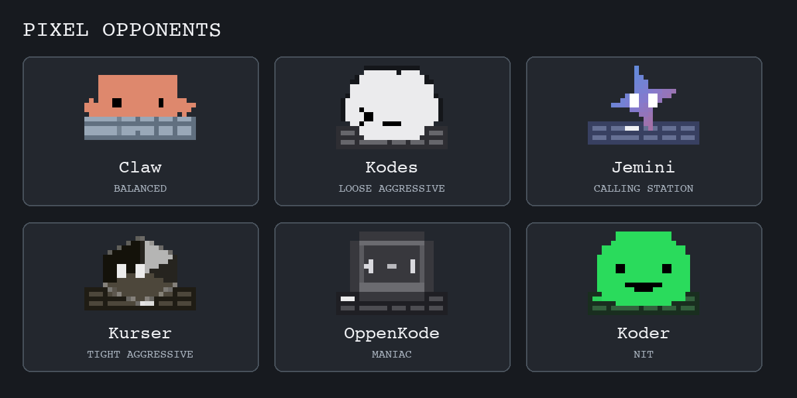

# 终端德州扑克

[English README](../README.md) · [玩家指南](user-guide.md) · [项目索引](index.md)

一款本地运行的无限注德州扑克游戏：你可以与最多 9 位内置电脑牌手对局，在终端打完一手后立即复盘，再用历史记录和训练工具回看自己的决策。启动时可选择中文或英文。

## 像素风格对手

电脑牌手有终端像素头像和谐音英文名。头像只是视觉形象，牌桌决策由本项目的内置扑克 AI 完成。新对局按固定顺序安排席位，前 6 位对手如下：

| 席位 | 对局显示名 | 打法风格 |
| --- | --- | --- |
| 1 | Claw | 均衡型 |
| 2 | Kodes | 松凶型 |
| 3 | Jemini | 跟注型 |
| 4 | Kurser | 紧凶型 |
| 5 | OppenKode | 激进型 |
| 6 | Koder | 紧手型 |

第 7–9 位会重复前三种风格，重名时在英文名后加数字。名字和头像按席位固定分配，并非每局随机。选择 7 位及以上电脑牌手时，自动牌桌显示会精简；轮到你行动时输入 `头像`，可以展开完整头像墙。



上图由游戏当前的终端头像数据绘制。头像采样来自 [CodeIsland 的 MIT 授权公仔动画](../assets/ai_avatars/codeisland/SOURCE.md)；相关产品没有参与或背书本游戏的电脑牌手。

## 本地运行

需要 Python 3.12 或兼容的 Python 3 版本，以及支持 UTF-8 的终端。游玩无需第三方 Python 包、账号或网络连接。

```bash
git clone https://github.com/JarvixGaby/terminal-texas-holdem.git
cd terminal-texas-holdem
./scripts/start.sh
```

也可以在项目目录运行 `python3 main.py`。启动时输入 `1` 选择中文，输入 `2` 选择英文；随后在主菜单选择“开始新游戏”，设置姓名、1–9 位电脑对手、盲注和起始筹码。每桌总人数为 2–10 人。

## 对局操作

| 命令 | 作用 |
| --- | --- |
| `过牌` 或 `check` | 无需跟注时跳过下注。 |
| `跟注` 或 `call` | 补齐需要跟注的金额。 |
| `下注`、`加注`、`bet` 或 `raise` | 按提示输入下注或加注金额。 |
| `弃牌` 或 `fold` | 放弃当前手牌。 |
| `状态` 或 `status` | 查看完整牌桌状态。 |
| `帮助` 或 `help` | 查看决策辅助分析。 |
| `头像` 或 `avatars` | 展开所有电脑牌手的像素头像。 |

英文界面也接受中文动作命令。确认提示支持 `是`、`否`、`返回`，也支持 `y`、`n`、`back`。每手结束后可以立即复盘；主菜单还提供历史记录、快速复盘、本地训练中心和玩家风格评测。决策建议与胜率属于练习用估算值。

支持彩色输出的终端会显示彩色头像；设置 `NO_COLOR=1` 可使用单色显示。

## 开发与验证

入口文件是 `main.py`；对局流程位于 `texas_holdem/engine/`，内置 AI 位于 `texas_holdem/ai/`，终端显示位于 `texas_holdem/ui/`，评估工具位于 `texas_holdem/analytics/`。完整目录见[项目索引](index.md)。

最近一次 [10 个种子 × 每种子 500 手的 AI 基准](reports/2026-10-26-calling-station-astra-medium-equity-check.md)通过了现有的完成率和合法动作门槛。对手风格仍在校准；[跟注型行动机会诊断](reports/2026-10-26-calling-station-opportunity-diagnostic.md)说明了跟注率仍被标记为 WARN 的原因。除非报告另有说明，基准会使用比正常终端对局更少的胜率采样次数。

开发环境安装 `pytest` 后可运行：

```bash
python3 -m pytest -q
```

手牌历史、玩家统计、SQLite 数据库和日志保存在本地项目目录，已被 Git 忽略。
